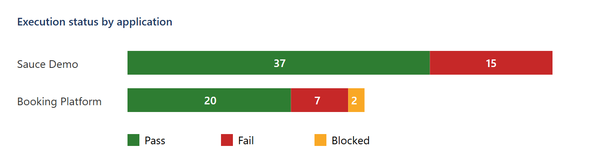
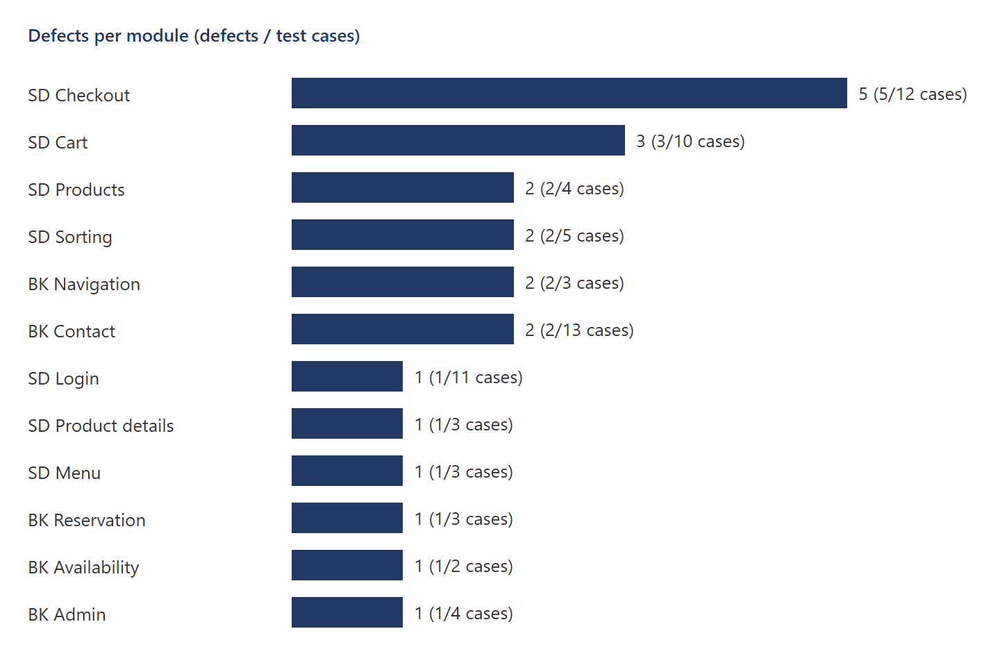
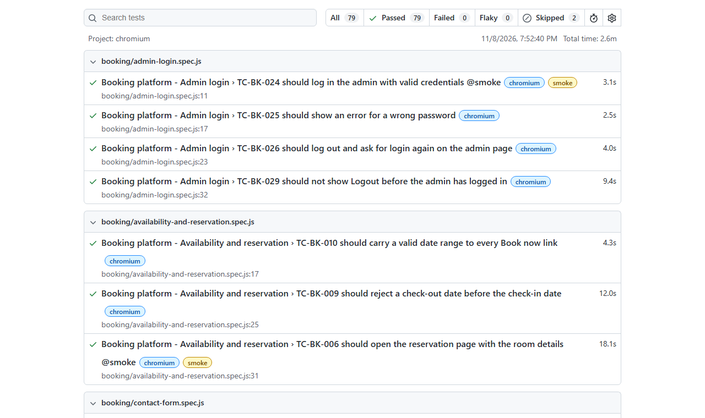

# Manual Testing Case Study — E-commerce and Hotel Booking

A complete manual QA cycle on two public practice web applications: plan → design → execute → report bugs →
summarise. 81 test cases, 22 real defects with evidence, a traceability matrix and a release recommendation.

[](https://github.com/the-sudipta/manual-testing-case-study/actions/workflows/execution.yml)
[](https://the-sudipta.github.io/manual-testing-case-study/)
[](LICENSE)

## What this project shows

- I can write a **test plan** (IEEE 829 / ISO 29119 style) with scope, approach, entry/exit criteria and risks.
- I design test cases with **formal techniques** — equivalence partitioning, boundary values, decision tables,
  state transition and error guessing — and label each case with its technique.
- I execute cases, record **honest results** (Pass / Fail / Blocked) and write **clear bug reports** with steps,
  expected vs actual, severity, priority and evidence.
- I keep **traceability** from requirement → test case → result → defect, and close the cycle with a
  **summary report** and a release recommendation.
- I use simple tooling (Excel, Markdown, Playwright, GitHub Issues, GitHub Actions) to make the work repeatable.

## Systems under test and scope

| Application | URL | Scope |
|---|---|---|
| Sauce Demo (e-commerce) | https://www.saucedemo.com | Login for all six demo users, product list, sorting, details, cart, checkout, menu, basic accessibility |
| Restful Booker Platform v2.2 (Shady Meadows B&B) | https://automationintesting.online | Front page, navigation, availability, reservation, contact form, admin login, policy pages |

Both sites are public practice applications that invite testers. Only fake test data was used.
Out of scope: performance, security and payment (see the [test plan](docs/test-plan.md)).

## Tech stack

Excel workbooks (my test case template) · Markdown · Playwright (replay of executed steps + evidence capture) ·
exceljs · GitHub Issues & Projects · GitHub Actions + Pages

## Project structure

```
manual-testing-case-study/
├─ docs/test-plan.md                     # test plan
├─ test-scenarios.md                     # scenarios per requirement
├─ test-cases/
│  ├─ Test_Cases_SauceDemo.xlsx          # 52 cases (+ .csv / .md copies)
│  ├─ Test_Cases_BookingPlatform.xlsx    # 29 cases (+ .csv / .md copies)
│  ├─ Test_Case_Template.xlsx            # empty template for reuse
│  └─ source/                            # single source of the cases and requirements
├─ requirements-traceability-matrix.xlsx
├─ bug-reports/                          # 22 reports + evidence/ (screenshots, API responses)
├─ exploratory/                          # 3 time-boxed session notes
├─ reports/test-summary-report.md        # results, defect density, charts, recommendation
├─ execution/                            # Playwright replay of each case (one spec per feature)
├─ scripts/                              # builds workbooks, bug reports, charts; publishes issues
└─ .github/                              # issue template, labels, CI workflow
```

## How to run

The cases are written for manual execution — open the workbooks and follow the steps. To replay them and
regenerate the results, workbooks, bug reports and charts:

**Windows (PowerShell)**
```powershell
npm ci
npx playwright install chromium
npm test            # replay all cases, then rebuild workbooks, bug reports and charts
npm run execute:smoke   # only the @smoke cases
```

**CI:** `.github/workflows/execution.yml` runs on every push and nightly, uploads the results and evidence
as artifacts and publishes the replay report to GitHub Pages.

Known defects are marked in the replay with `test.fail` and their bug ID. The run stays green while the defect
exists; if a defect gets fixed, the case shows up as an *unexpected pass* and tells me to retest and close it.

## Test coverage summary

| Area | Cases | Pass | Fail | Blocked |
|---|---|---|---|---|
| Sauce Demo — Login | 11 | 10 | 1 | 0 |
| Sauce Demo — Products, sorting, details | 12 | 7 | 5 | 0 |
| Sauce Demo — Cart | 10 | 7 | 3 | 0 |
| Sauce Demo — Checkout | 12 | 7 | 5 | 0 |
| Sauce Demo — Menu, footer, accessibility, UI | 7 | 6 | 1 | 0 |
| Booking — Home, navigation, policies | 7 | 5 | 2 | 0 |
| Booking — Availability and reservation | 5 | 1 | 2 | 2 |
| Booking — Contact form | 13 | 11 | 2 | 0 |
| Booking — Admin | 4 | 3 | 1 | 0 |
| **Total** | **81** | **57** | **22** | **2** |

Techniques: EP 37 · ST 15 · BVA 11 · DT 10 · EG 8. All 17 requirements are covered
([RTM](requirements-traceability-matrix.xlsx)).

## Bugs found

22 defects: 3 Critical, 12 Major, 5 Minor, 2 Trivial — full list in [bug-reports/](bug-reports/README.md).

| ID | Title | Severity |
|---|---|---|
| [BUG-016](bug-reports/BUG-016-reservation-page-never-loads-get-api-room-id-returns-500.md) | Reservation page never loads: GET /api/room/{id} returns 500 | Critical |
| [BUG-007](bug-reports/BUG-007-problem-user-typing-in-last-name-overwrites-first-name-check.md) | problem_user: typing in Last Name overwrites First Name | Critical |
| [BUG-009](bug-reports/BUG-009-error-user-finish-button-does-nothing-the-order-cannot-be-co.md) | error_user: Finish button does nothing | Critical |
| [BUG-001](bug-reports/BUG-001-item-total-shows-an-unrounded-value-121-94999999999999-on-th.md) | Item total shows $121.94999999999999 on the overview | Major |
| [BUG-017](bug-reports/BUG-017-check-availability-accepts-a-check-out-date-before-the-check.md) | Availability accepts check-out before check-in | Major |
| [BUG-012](bug-reports/BUG-012-visual-user-product-prices-differ-from-the-catalogue-and-cha.md) | visual_user: prices differ from the catalogue | Major |
| [BUG-014](bug-reports/BUG-014-checkout-is-allowed-with-an-empty-cart-and-completes-a-0-00-.md) | Empty cart can be checked out ($0.00 order) | Minor |
| [BUG-020](bug-reports/BUG-020-contact-form-accepts-a-phone-number-made-of-letters.md) | Contact form accepts a phone made of letters | Minor |

## Reports and screenshots

- [Test summary report](reports/test-summary-report.md) — recommendation: **not ready for release**
- Live replay report: https://the-sudipta.github.io/manual-testing-case-study/





## Design decisions and what I would do next

- **One source for every case.** Cases live in `test-cases/source`; the Excel, CSV and Markdown copies are
  generated, so they never disagree.
- **Evidence first.** A defect is only reported after it was reproduced twice; every report links a screenshot
  or a raw API response.
- **Honest status.** Cases that cannot run are *Blocked* with the blocking bug, not *Pass* or *Fail*.
- Next: retest BUG-016 and explore the reservation form; add Firefox and WebKit to the replay; run a short
  accessibility audit with axe.

## Author

**Sudipta Kumar Das** — Junior SQA Engineer (manual, API, automation) · [GitHub](https://github.com/the-sudipta)

Copyright © 2026 Sudipta Kumar Das. All rights reserved — see [LICENSE](LICENSE).
