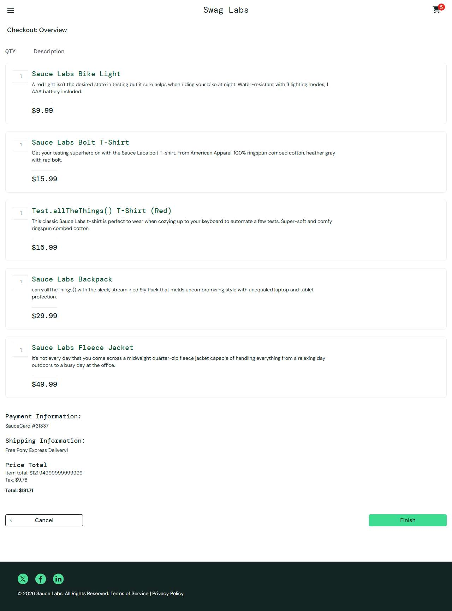

# BUG-001: Item total shows an unrounded value $121.94999999999999 on the checkout overview

| Field | Value |
|---|---|
| Application | Sauce Demo (https://www.saucedemo.com) |
| Module | Checkout |
| Severity | Major |
| Priority | P2 |
| Status | Open |
| Found by | TC-SD-038 |
| Environment | Windows 11, Chromium (Playwright build) and Microsoft Edge, 1280×720 |
| Reported | 2026-11-08 by Sudipta Kumar Das |

## Steps to reproduce
1. Open https://www.saucedemo.com and log in as `standard_user` / `secret_sauce`
2. Sort by "Price (low to high)"
3. Add Bike Light, Bolt T-Shirt, Test.allTheThings() T-Shirt (Red), Backpack and Fleece Jacket in this order
4. Open the cart → Checkout → enter Rahim / Uddin / 1207 → Continue

## Expected result
"Item total: $121.95" (two decimals, like Tax and Total).

## Actual result
"Item total: $121.94999999999999". Tax ($9.76) and Total ($131.71) are rounded correctly. With an empty cart the item total shows "$0" instead of "$0.00".

## Notes
The value depends on the order the prices are added (floating-point sum). The same five items added in another order show $121.95.

## Evidence

