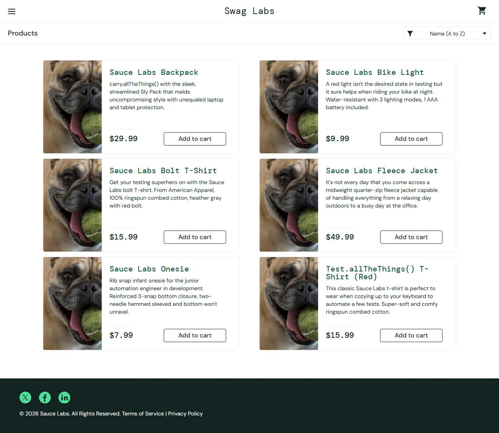

# BUG-002: problem_user: all six products show the same dog image

| Field | Value |
|---|---|
| Application | Sauce Demo (https://www.saucedemo.com) |
| Module | Products |
| Severity | Major |
| Priority | P2 |
| Status | Open |
| Found by | TC-SD-014 |
| Environment | Windows 11, Chromium (Playwright build) and Microsoft Edge, 1280×720 |
| Reported | 2026-11-08 by Sudipta Kumar Das |

## Steps to reproduce
1. Open https://www.saucedemo.com and log in as `problem_user` / `secret_sauce`
2. Look at the product images on the Products page

## Expected result
Each product shows its own image (backpack, bike light, t-shirts, jacket, onesie).

## Actual result
All six products show the same picture of a dog; the image source is identical for every item.

## Evidence

