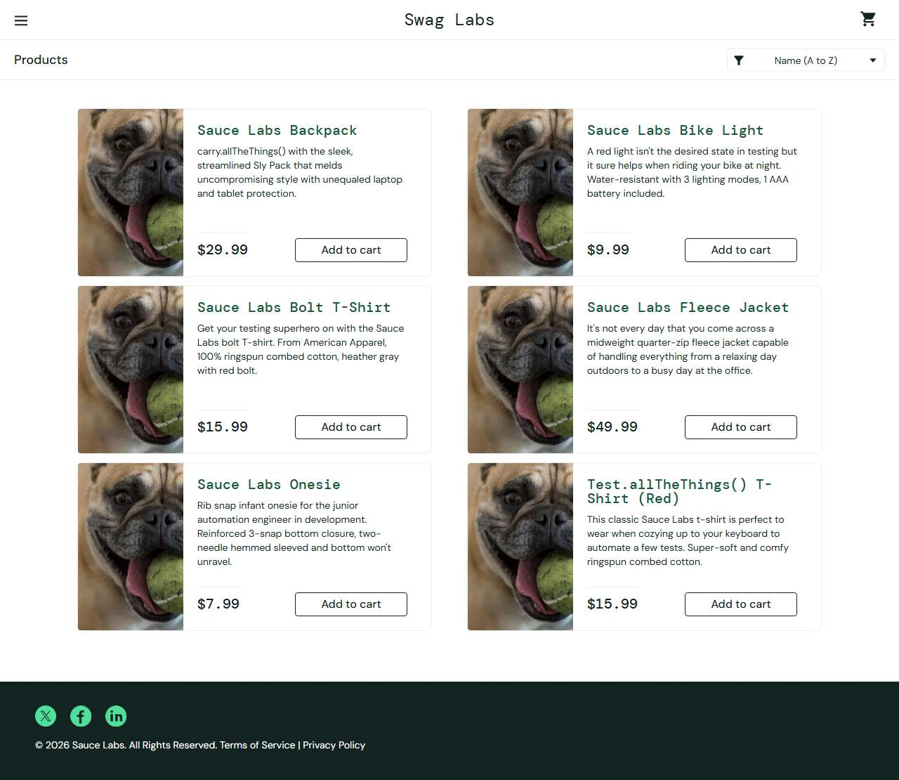

# BUG-003: problem_user: sorting the product list has no effect

| Field | Value |
|---|---|
| Application | Sauce Demo (https://www.saucedemo.com) |
| Module | Sorting |
| Severity | Major |
| Priority | P2 |
| Status | Open |
| Found by | TC-SD-018 |
| Environment | Windows 11, Chromium (Playwright build) and Microsoft Edge, 1280×720 |
| Reported | 2026-11-08 by Sudipta Kumar Das |

## Steps to reproduce
1. Open https://www.saucedemo.com and log in as `problem_user` / `secret_sauce`
2. Select "Name (Z to A)" in the sort dropdown
3. Repeat with "Price (low to high)"

## Expected result
The list is re-ordered according to the selected option.

## Actual result
The list keeps the default A to Z order for every option.

## Evidence

