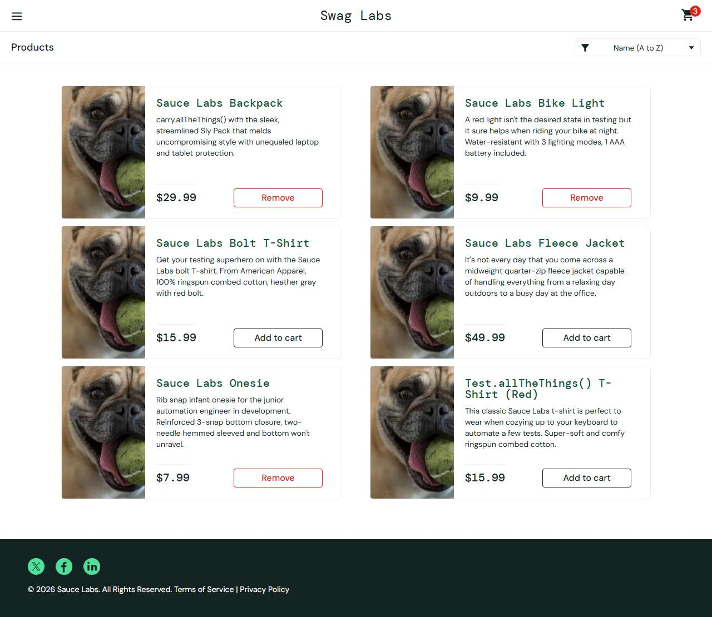

# BUG-004: problem_user: Add to cart does nothing for three of the six products

| Field | Value |
|---|---|
| Application | Sauce Demo (https://www.saucedemo.com) |
| Module | Cart |
| Severity | Major |
| Priority | P1 |
| Status | Open |
| Found by | TC-SD-031 |
| Environment | Windows 11, Chromium (Playwright build) and Microsoft Edge, 1280×720 |
| Reported | 2026-11-08 by Sudipta Kumar Das |

## Steps to reproduce
1. Open https://www.saucedemo.com and log in as `problem_user` / `secret_sauce`
2. Click "Add to cart" on every product

## Expected result
All six buttons change to "Remove" and the badge shows 6.

## Actual result
Only Backpack, Bike Light and Onesie are added. Bolt T-Shirt, Fleece Jacket and Test.allTheThings() T-Shirt (Red) keep "Add to cart" and the badge shows 3.

## Evidence

