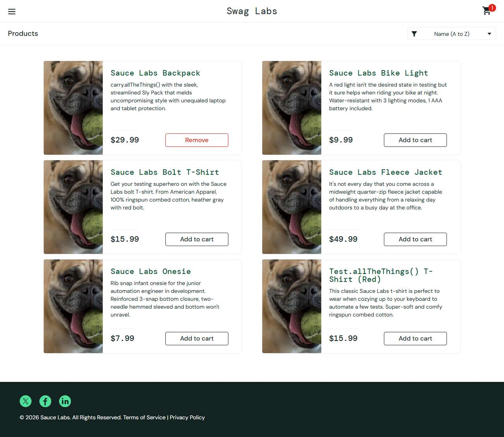

# BUG-005: problem_user: Remove button on the Products page does not remove the item

| Field | Value |
|---|---|
| Application | Sauce Demo (https://www.saucedemo.com) |
| Module | Cart |
| Severity | Major |
| Priority | P2 |
| Status | Open |
| Found by | TC-SD-032 |
| Environment | Windows 11, Chromium (Playwright build) and Microsoft Edge, 1280×720 |
| Reported | 2026-11-08 by Sudipta Kumar Das |

## Steps to reproduce
1. Open https://www.saucedemo.com and log in as `problem_user` / `secret_sauce`
2. Click "Add to cart" on Sauce Labs Backpack
3. Click "Remove" on the same product

## Expected result
The item is removed, the badge disappears and the button changes back to "Add to cart".

## Actual result
Nothing happens; the badge stays 1 and the button stays "Remove".

## Evidence

