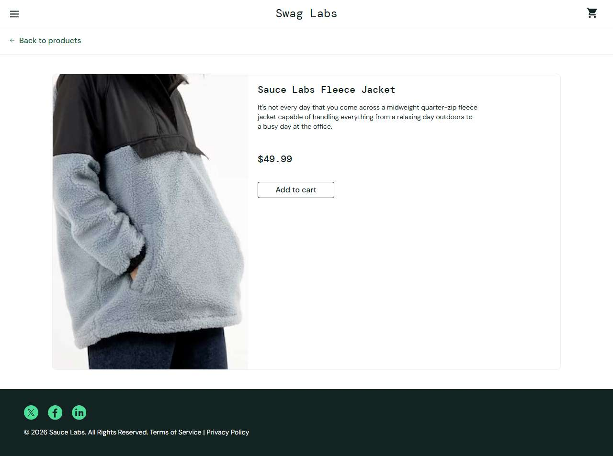

# BUG-006: problem_user: clicking a product opens a different product page

| Field | Value |
|---|---|
| Application | Sauce Demo (https://www.saucedemo.com) |
| Module | Product details |
| Severity | Major |
| Priority | P2 |
| Status | Open |
| Found by | TC-SD-023 |
| Environment | Windows 11, Chromium (Playwright build) and Microsoft Edge, 1280×720 |
| Reported | 2026-11-08 by Sudipta Kumar Das |

## Steps to reproduce
1. Open https://www.saucedemo.com and log in as `problem_user` / `secret_sauce`
2. Click the name "Sauce Labs Backpack"

## Expected result
The Sauce Labs Backpack detail page opens.

## Actual result
The "Sauce Labs Fleece Jacket" page opens (inventory-item.html?id=5).

## Evidence

