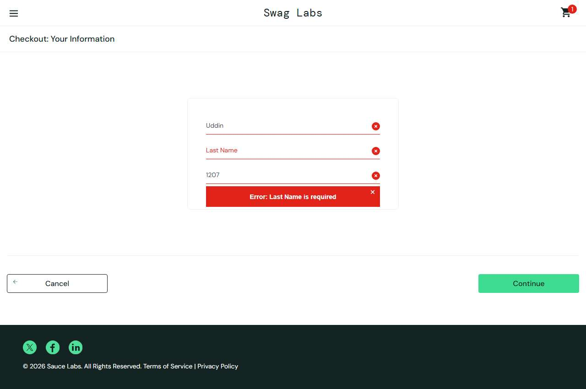

# BUG-007: problem_user: typing in Last Name overwrites First Name, checkout cannot continue

| Field | Value |
|---|---|
| Application | Sauce Demo (https://www.saucedemo.com) |
| Module | Checkout |
| Severity | Critical |
| Priority | P1 |
| Status | Open |
| Found by | TC-SD-041 |
| Environment | Windows 11, Chromium (Playwright build) and Microsoft Edge, 1280×720 |
| Reported | 2026-11-08 by Sudipta Kumar Das |

## Steps to reproduce
1. Open https://www.saucedemo.com and log in as `problem_user` / `secret_sauce`
2. Add any product, open the cart and click Checkout
3. Type "Rahim" in First Name
4. Type "Uddin" in Last Name
5. Type "1207" in Postal Code and click Continue

## Expected result
First Name = Rahim, Last Name = Uddin; the overview page opens.

## Actual result
Each key typed in Last Name replaces the First Name value (it ends as "n"), Last Name stays empty and "Error: Last Name is required" blocks the checkout. No workaround.

## Evidence

