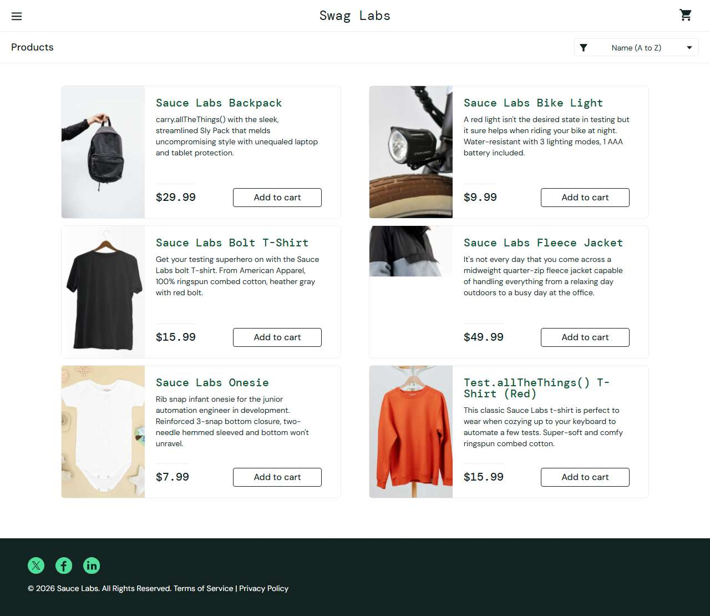

# BUG-008: error_user: sorting shows "Sorting is broken!" alert and does not sort

| Field | Value |
|---|---|
| Application | Sauce Demo (https://www.saucedemo.com) |
| Module | Sorting |
| Severity | Major |
| Priority | P2 |
| Status | Open |
| Found by | TC-SD-019 |
| Environment | Windows 11, Chromium (Playwright build) and Microsoft Edge, 1280×720 |
| Reported | 2026-11-08 by Sudipta Kumar Das |

## Steps to reproduce
1. Open https://www.saucedemo.com and log in as `error_user` / `secret_sauce`
2. Select "Name (Z to A)" in the sort dropdown

## Expected result
The list is sorted Z to A without any error.

## Actual result
A browser alert says "Sorting is broken! This error has been reported to Backtrace." and the list stays A to Z.

## Evidence

