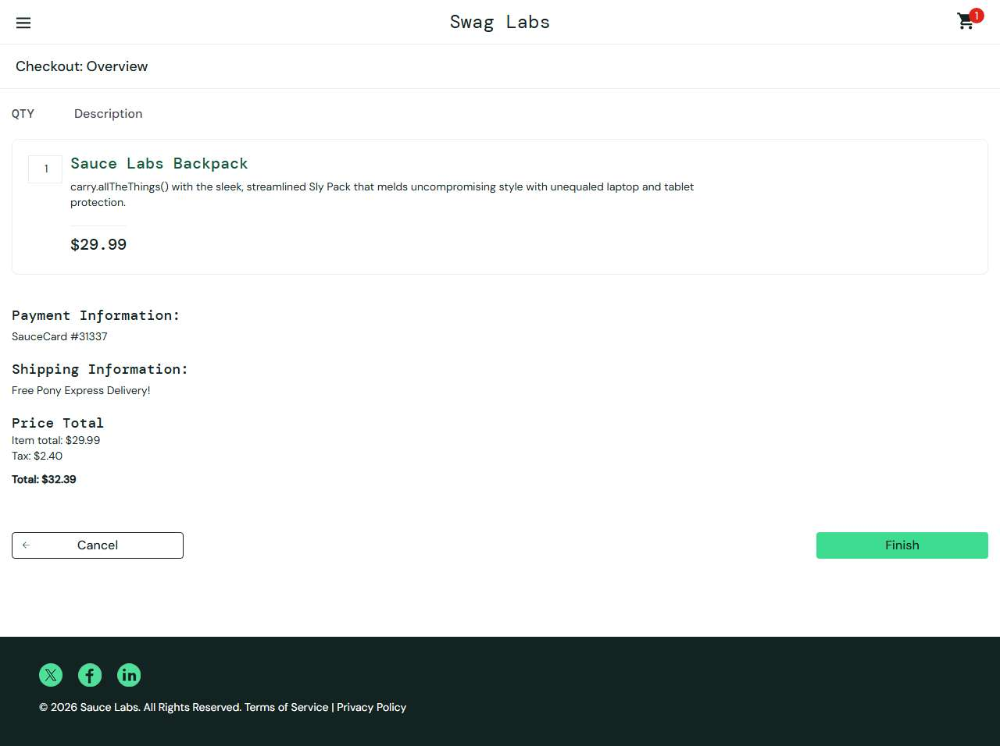

# BUG-009: error_user: Finish button does nothing, the order cannot be completed

| Field | Value |
|---|---|
| Application | Sauce Demo (https://www.saucedemo.com) |
| Module | Checkout |
| Severity | Critical |
| Priority | P1 |
| Status | Open |
| Found by | TC-SD-042 |
| Environment | Windows 11, Chromium (Playwright build) and Microsoft Edge, 1280×720 |
| Reported | 2026-11-08 by Sudipta Kumar Das |

## Steps to reproduce
1. Open https://www.saucedemo.com and log in as `error_user` / `secret_sauce`
2. Add Sauce Labs Backpack, open the cart and click Checkout
3. Enter Rahim / Uddin / 1207 and click Continue
4. Click Finish on the overview page

## Expected result
"Thank you for your order!" page opens and the cart is emptied.

## Actual result
The page stays on Checkout: Overview; no message, no navigation. The order cannot be placed.

## Evidence

