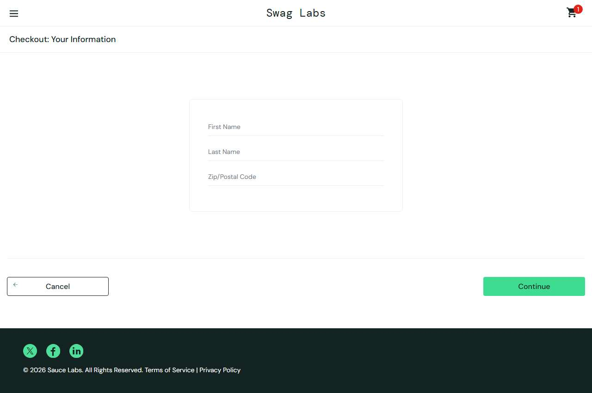

# BUG-010: error_user: Last Name field ignores input but Continue is still accepted

| Field | Value |
|---|---|
| Application | Sauce Demo (https://www.saucedemo.com) |
| Module | Checkout |
| Severity | Major |
| Priority | P2 |
| Status | Open |
| Found by | TC-SD-051 |
| Environment | Windows 11, Chromium (Playwright build) and Microsoft Edge, 1280×720 |
| Reported | 2026-11-08 by Sudipta Kumar Das |

## Steps to reproduce
1. Open https://www.saucedemo.com and log in as `error_user` / `secret_sauce`
2. Add any product, open the cart and click Checkout
3. Type "Uddin" in Last Name
4. Fill First Name and Postal Code, click Continue

## Expected result
Last Name shows "Uddin"; if it were empty, "Last Name is required" would be shown.

## Actual result
Last Name stays empty, yet Continue opens the overview page — the required-field check is skipped.

## Evidence

