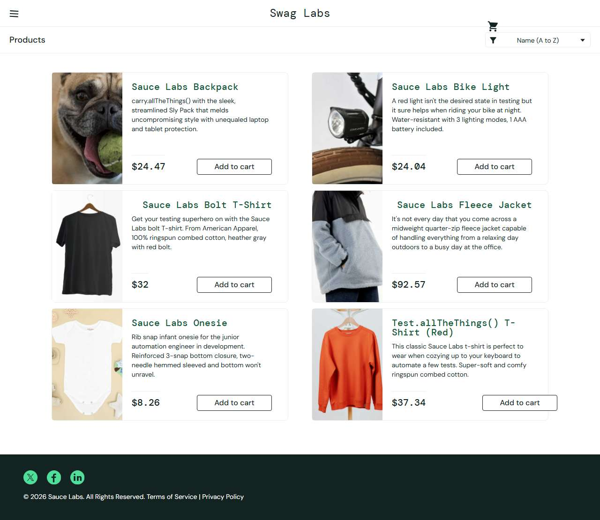

# BUG-012: visual_user: product prices differ from the catalogue and change on every load

| Field | Value |
|---|---|
| Application | Sauce Demo (https://www.saucedemo.com) |
| Module | Products |
| Severity | Major |
| Priority | P1 |
| Status | Open |
| Found by | TC-SD-020 |
| Environment | Windows 11, Chromium (Playwright build) and Microsoft Edge, 1280×720 |
| Reported | 2026-11-08 by Sudipta Kumar Das |

## Steps to reproduce
1. Open https://www.saucedemo.com and log in as `visual_user` / `secret_sauce`
2. Note the prices on the Products page
3. Reload the page and note them again
4. Add Sauce Labs Backpack and open the cart

## Expected result
Catalogue prices (Backpack $29.99, Bike Light $9.99 …) on every load, same as in the cart.

## Actual result
Random prices are shown and change on each reload (e.g. Backpack $51.09); the cart then shows $29.99. The user sees one price and pays another.

## Evidence

