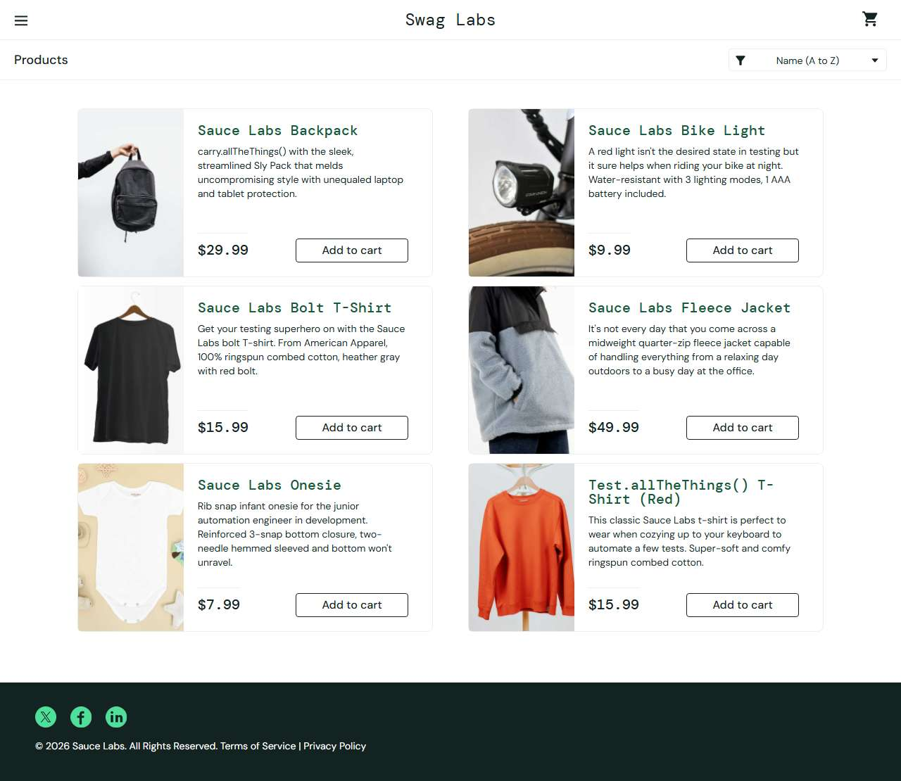

# BUG-013: performance_glitch_user: login takes about 5 seconds

| Field | Value |
|---|---|
| Application | Sauce Demo (https://www.saucedemo.com) |
| Module | Login |
| Severity | Major |
| Priority | P2 |
| Status | Open |
| Found by | TC-SD-010 |
| Environment | Windows 11, Chromium (Playwright build) and Microsoft Edge, 1280×720 |
| Reported | 2026-11-08 by Sudipta Kumar Das |

## Steps to reproduce
1. Open the login page
2. Enter performance_glitch_user / secret_sauce
3. Click Login and measure until the product list is shown

## Expected result
Product list within 4 seconds (standard_user: under 1 second on the same machine).

## Actual result
The product list appears after about 5.3 seconds with no loading indicator.

## Evidence

