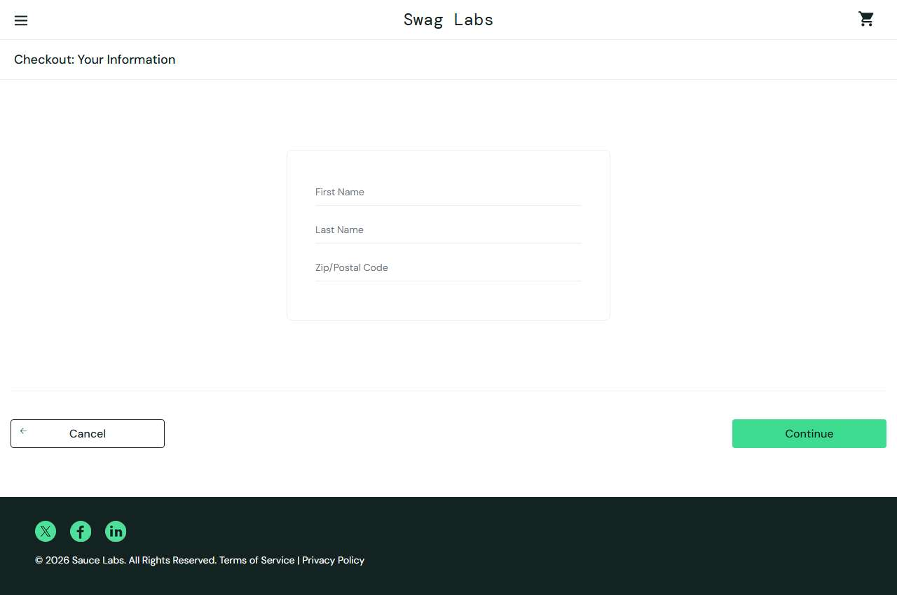

# BUG-014: Checkout is allowed with an empty cart and completes a $0.00 order

| Field | Value |
|---|---|
| Application | Sauce Demo (https://www.saucedemo.com) |
| Module | Checkout |
| Severity | Minor |
| Priority | P2 |
| Status | Open |
| Found by | TC-SD-043 |
| Environment | Windows 11, Chromium (Playwright build) and Microsoft Edge, 1280×720 |
| Reported | 2026-11-08 by Sudipta Kumar Das |

## Steps to reproduce
1. Open https://www.saucedemo.com and log in as `standard_user` / `secret_sauce`
2. Make sure the cart is empty and open it
3. Click Checkout, enter Rahim / Uddin / 1207, click Continue
4. Click Finish

## Expected result
Checkout is disabled or a message asks the user to add an item.

## Actual result
The overview shows "Item total: $0", "Total: $0.00" and Finish shows "Thank you for your order!".

## Evidence

