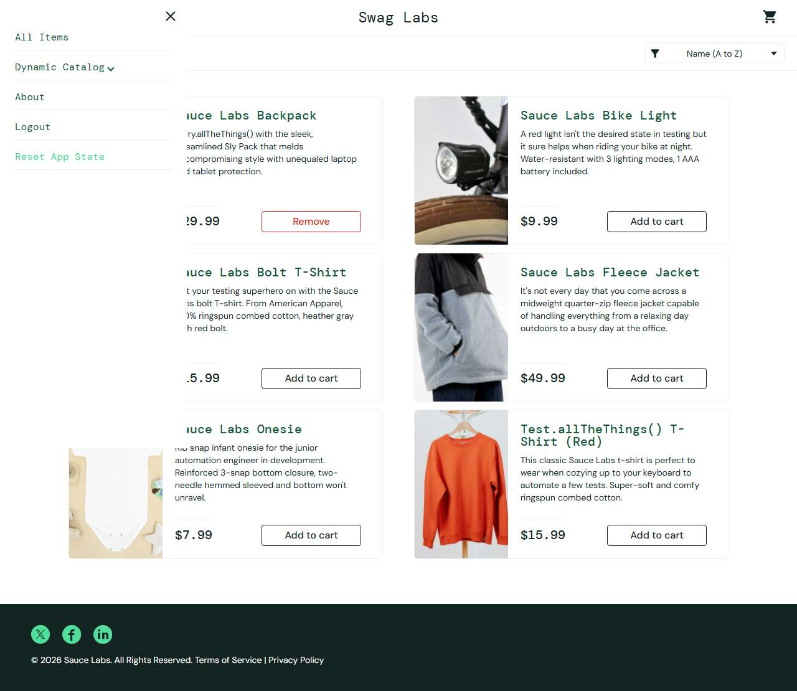

# BUG-015: Reset App State clears the badge but product buttons still show "Remove"

| Field | Value |
|---|---|
| Application | Sauce Demo (https://www.saucedemo.com) |
| Module | Menu |
| Severity | Minor |
| Priority | P3 |
| Status | Open |
| Found by | TC-SD-045 |
| Environment | Windows 11, Chromium (Playwright build) and Microsoft Edge, 1280×720 |
| Reported | 2026-11-08 by Sudipta Kumar Das |

## Steps to reproduce
1. Open https://www.saucedemo.com and log in as `standard_user` / `secret_sauce`
2. Add Sauce Labs Backpack
3. Open the menu and click Reset App State

## Expected result
Badge removed and the Backpack button shows "Add to cart".

## Actual result
Badge is removed but the Backpack button still shows "Remove" until the page is reloaded; the UI and cart disagree.

## Evidence

