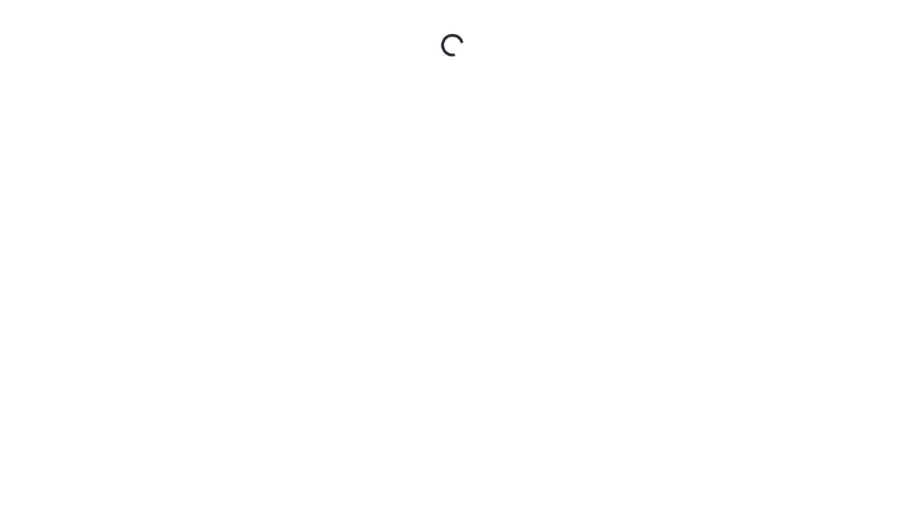

# BUG-016: Reservation page never loads: GET /api/room/{id} returns 500

| Field | Value |
|---|---|
| Application | Restful Booker Platform (https://automationintesting.online) |
| Module | Reservation |
| Severity | Critical |
| Priority | P1 |
| Status | Open |
| Found by | TC-BK-006, TC-BK-007, TC-BK-008 |
| Environment | Windows 11, Chromium (Playwright build) and Microsoft Edge, 1280×720 |
| Reported | 2026-11-08 by Sudipta Kumar Das |

## Steps to reproduce
1. Open https://automationintesting.online
2. Click "Book now" on any room (e.g. Single, room 1)

## Expected result
The reservation page shows the room details, a calendar and "Reserve Now".

## Actual result
The page shows a loading spinner forever. GET /api/room/1, /2 and /3 return "500 Internal Server Error"; the page then throws "Unexpected token 'I', \"Internal S\"... is not valid JSON" in the console. No room can be booked.

## Notes
GET /api/room (list) still returns 200. Checked several times between 13:15 and 13:55 UTC on 2026-11-08. Because this is a shared demo backend it may be environmental; it blocks TC-BK-007 and TC-BK-008.

## Evidence

- [BUG-016-api-room-500.txt](evidence/BUG-016-api-room-500.txt)
