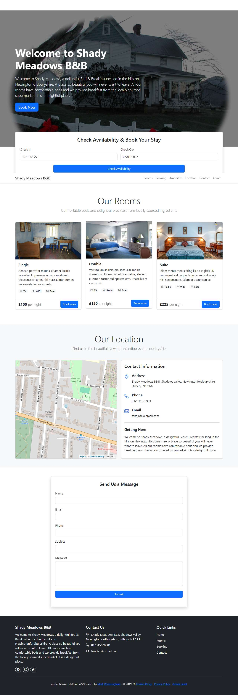

# BUG-017: Check Availability accepts a check-out date before the check-in date

| Field | Value |
|---|---|
| Application | Restful Booker Platform (https://automationintesting.online) |
| Module | Availability |
| Severity | Major |
| Priority | P2 |
| Status | Open |
| Found by | TC-BK-009 |
| Environment | Windows 11, Chromium (Playwright build) and Microsoft Edge, 1280×720 |
| Reported | 2026-11-08 by Sudipta Kumar Das |

## Steps to reproduce
1. Open https://automationintesting.online
2. Set Check In to a date 65 days ahead and Check Out to 60 days ahead
3. Click Check Availability

## Expected result
An error such as "Check-out must be after check-in"; no rooms offered.

## Actual result
No error. GET /api/room?checkin=…&checkout=… (reversed) returns 200 and every room is offered with a Book now link carrying the reversed dates.

## Evidence

