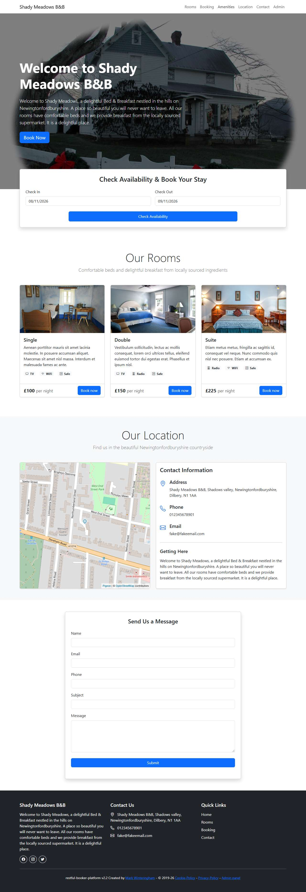

# BUG-018: Navbar "Amenities" link goes nowhere: the page has no amenities section

| Field | Value |
|---|---|
| Application | Restful Booker Platform (https://automationintesting.online) |
| Module | Navigation |
| Severity | Minor |
| Priority | P3 |
| Status | Open |
| Found by | TC-BK-004 |
| Environment | Windows 11, Chromium (Playwright build) and Microsoft Edge, 1280×720 |
| Reported | 2026-11-08 by Sudipta Kumar Das |

## Steps to reproduce
1. Open https://automationintesting.online
2. Click "Amenities" in the navbar

## Expected result
The page scrolls to an Amenities section.

## Actual result
The URL changes to /#amenities but the page does not move; no element with id "amenities" exists.

## Evidence

