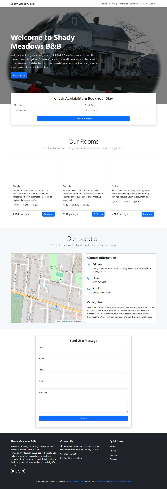

# BUG-019: Footer Quick Links (Home, Rooms, Booking, Contact) all point to "#"

| Field | Value |
|---|---|
| Application | Restful Booker Platform (https://automationintesting.online) |
| Module | Navigation |
| Severity | Minor |
| Priority | P3 |
| Status | Open |
| Found by | TC-BK-005 |
| Environment | Windows 11, Chromium (Playwright build) and Microsoft Edge, 1280×720 |
| Reported | 2026-11-08 by Sudipta Kumar Das |

## Steps to reproduce
1. Open https://automationintesting.online
2. Scroll to the footer
3. Click Rooms (or Booking / Contact) under Quick Links

## Expected result
Each link goes to its section, like the navbar links do.

## Actual result
All four links have href="#" and only jump to the top of the page. The three social icons in the footer are also href="#".

## Evidence

