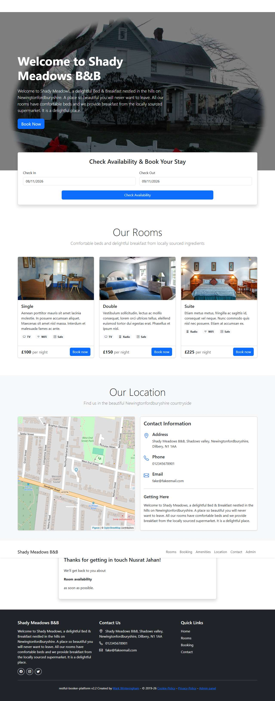

# BUG-020: Contact form accepts a phone number made of letters

| Field | Value |
|---|---|
| Application | Restful Booker Platform (https://automationintesting.online) |
| Module | Contact |
| Severity | Minor |
| Priority | P2 |
| Status | Open |
| Found by | TC-BK-022 |
| Environment | Windows 11, Chromium (Playwright build) and Microsoft Edge, 1280×720 |
| Reported | 2026-11-08 by Sudipta Kumar Das |

## Steps to reproduce
1. Open https://automationintesting.online
2. Fill the contact form with valid data but Phone = "abcdefghijk"
3. Click Submit

## Expected result
Phone is rejected: it must contain digits (and optionally + or spaces).

## Actual result
The message is accepted (POST /api/message → 200 {"success":true}) and "Thanks for getting in touch" is shown. Only the length 11–21 is checked.

## Evidence

- [BUG-020-phone-letters-accepted.txt](evidence/BUG-020-phone-letters-accepted.txt)
