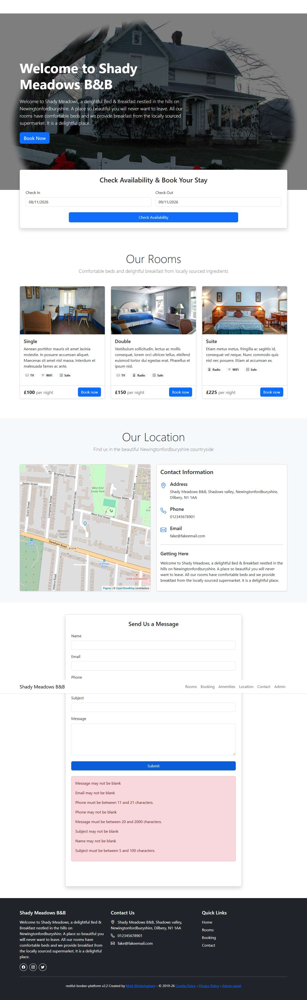

# BUG-021: Contact form shows eight duplicated error messages, not in form order

| Field | Value |
|---|---|
| Application | Restful Booker Platform (https://automationintesting.online) |
| Module | Contact |
| Severity | Trivial |
| Priority | P3 |
| Status | Open |
| Found by | TC-BK-023 |
| Environment | Windows 11, Chromium (Playwright build) and Microsoft Edge, 1280×720 |
| Reported | 2026-11-08 by Sudipta Kumar Das |

## Steps to reproduce
1. Open https://automationintesting.online
2. Leave every contact field empty and click Submit

## Expected result
One clear message per field (5), next to or in the order of the fields.

## Actual result
One box with eight messages in an order that does not follow the form; Subject, Message and Phone each get both "may not be blank" and a length message.

## Evidence

