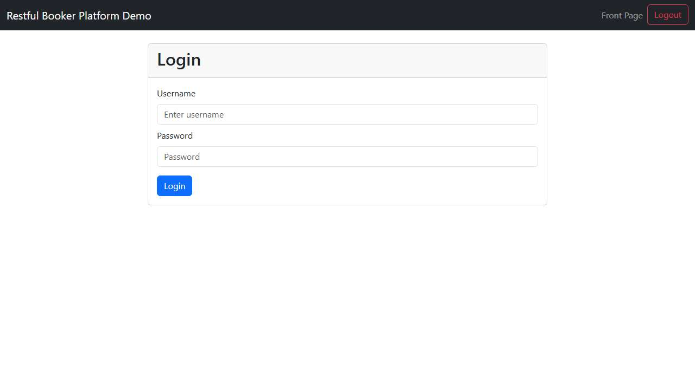

# BUG-022: Admin login page shows a "Logout" button before anyone has logged in

| Field | Value |
|---|---|
| Application | Restful Booker Platform (https://automationintesting.online) |
| Module | Admin |
| Severity | Trivial |
| Priority | P3 |
| Status | Open |
| Found by | TC-BK-029 |
| Environment | Windows 11, Chromium (Playwright build) and Microsoft Edge, 1280×720 |
| Reported | 2026-11-08 by Sudipta Kumar Das |

## Steps to reproduce
1. Open https://automationintesting.online/admin without being logged in
2. Look at the navbar

## Expected result
Only login-related navigation; no Logout button while logged out.

## Actual result
The navbar shows "Front Page" and "Logout" above the login form.

## Evidence

