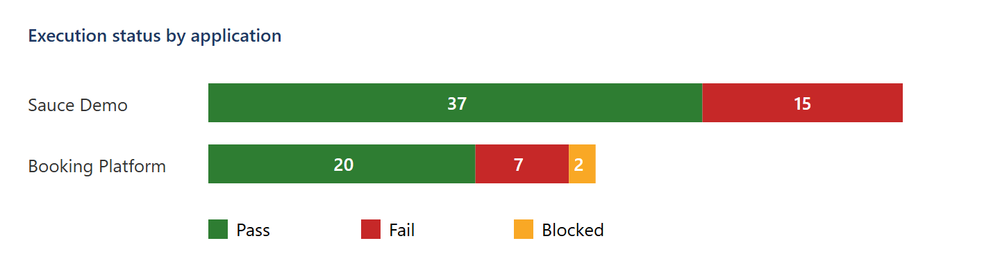
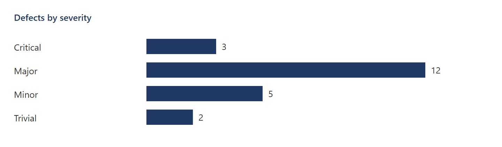
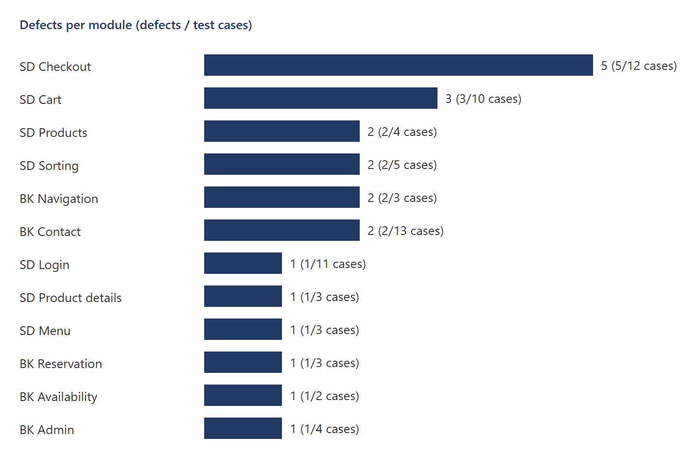

# Test Summary Report

| Field | Value |
|---|---|
| Document ID | TSR-MTCS-001 (follows test plan TP-MTCS-001) |
| Test window | 2026-11-08, 13:10 – 14:00 UTC (recorded run 13:52 – 13:55 UTC) |
| Applications | Sauce Demo, Restful Booker Platform v2.2 ("Shady Meadows B&B") |
| Environment | Windows 11, Chromium (Playwright build) for the recorded run, Microsoft Edge for manual re-checks, 1280×720 |
| Prepared by | Sudipta Kumar Das |

## 1. Summary

81 test cases were designed and 79 were executed. 57 passed, 22 failed and 2 were blocked. 22 real defects
were reported (3 Critical, 12 Major, 5 Minor, 2 Trivial). Every failed case is linked to exactly one defect.

**Recommendation: not ready for release.** The booking journey on the Restful Booker Platform is fully blocked
(BUG-016), and the standard Sauce Demo user is affected by an unrounded price on the checkout overview (BUG-001)
and by an empty-cart checkout (BUG-014). The special Sauce Demo users show the defects they are known for;
in a real product each of them would be a release blocker for the affected user group.

## 2. Execution results

| Application | Designed | Executed | Passed | Failed | Blocked | Pass rate (executed) |
|---|---|---|---|---|---|---|
| Sauce Demo | 52 | 52 | 37 | 15 | 0 | 71.2% |
| Restful Booker Platform | 29 | 27 | 20 | 7 | 2 | 74.1% |
| **Total** | **81** | **79** | **57** | **22** | **2** | **72.2%** |

Blocked: TC-BK-007 and TC-BK-008 (reserve a room, valid and empty details) cannot run because the reservation
page never loads (BUG-016).

### Test design techniques used

| Technique | Sauce Demo | Booking | Total |
|---|---|---|---|
| Equivalence Partitioning (EP) | 23 | 14 | 37 |
| State Transition (ST) | 12 | 3 | 15 |
| Boundary Value Analysis (BVA) | 3 | 8 | 11 |
| Decision Table (DT) | 7 | 3 | 10 |
| Error Guessing (EG) | 7 | 1 | 8 |

## 3. Defects

| Severity | Count | IDs |
|---|---|---|
| Critical | 3 | BUG-007, BUG-009, BUG-016 |
| Major | 12 | BUG-001 – BUG-006, BUG-008, BUG-010 – BUG-013, BUG-017 |
| Minor | 5 | BUG-014, BUG-015, BUG-018 – BUG-020 |
| Trivial | 2 | BUG-021, BUG-022 |

### Defect density by module

Defect density here = number of defects in a module ÷ number of test cases for that module.

| Module | Defects | Cases | Density |
|---|---|---|---|
| SD Checkout | 5 | 12 | 0.42 |
| SD Cart | 3 | 10 | 0.30 |
| SD Products | 2 | 4 | 0.50 |
| SD Sorting | 2 | 5 | 0.40 |
| BK Navigation | 2 | 3 | 0.67 |
| BK Contact | 2 | 13 | 0.15 |
| BK Reservation | 1 | 3 | 0.33 (and blocks 2 more) |
| BK Availability | 1 | 2 | 0.50 |
| BK Admin | 1 | 4 | 0.25 |
| SD Login, Product details, Menu | 1 each | 11 / 3 / 3 | 0.09 / 0.33 / 0.33 |

**Observations**

- Checkout is the riskiest Sauce Demo area: two users cannot buy at all (BUG-007, BUG-009) and the price
  shown can be wrong (BUG-001, BUG-012).
- On the booking platform the main journey is blocked by the backend (BUG-016); the front end also does not
  validate the date range (BUG-017), so once the backend works, invalid bookings may reach it.
- Input validation on the contact form works for lengths and email format (all 8 boundary cases behaved as
  specified) but not for the phone content (BUG-020).

## 4. Exit criteria check

| Criterion | Result |
|---|---|
| 100% of planned cases executed or blocked with a reason | Met (79 executed, 2 blocked with reason) |
| All Critical and Major defects reported with evidence | Met (15 of 15) |
| Every requirement covered (RTM) | Met (17 of 17 requirements have at least one case) |
| Summary report with recommendation | Met (this document) |

## 5. Exploratory testing

Three time-boxed sessions (45 minutes each) were run in addition to the scripted cases — see `exploratory/`.
They produced 10 of the 22 defects (BUG-001, BUG-014 – BUG-022) that were then turned into scripted cases.

## 6. Recommendations

1. Fix BUG-016 first and re-run TC-BK-006 to TC-BK-008 (the replay script marks them for retest automatically).
2. Add a front-end date-range check (BUG-017) and a phone pattern check (BUG-020) together with matching
   server-side validation.
3. Round all money values to two decimals in one place (BUG-001) and block checkout for an empty cart (BUG-014).
4. Keep the replay scripts in the nightly CI run: any defect that gets fixed shows up as an "unexpected pass".

## 7. Limitations

- Both applications are public demo sites; the booking data is shared and resets, and its backend may be
  unstable (BUG-016 may be environmental).
- The recorded run used Chromium only; Edge was used for manual re-checks. Firefox and WebKit were not part of
  this cycle.
- No written requirements exist; expected results were derived from the standard user's behaviour, visible
  UI text and API messages (listed in the RTM).
